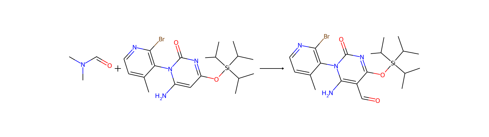
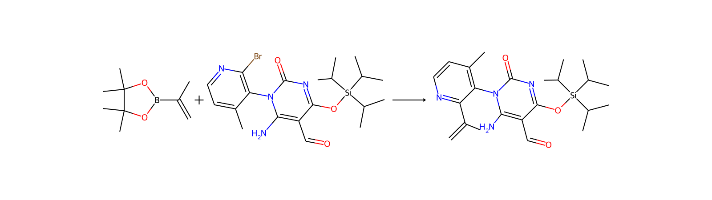
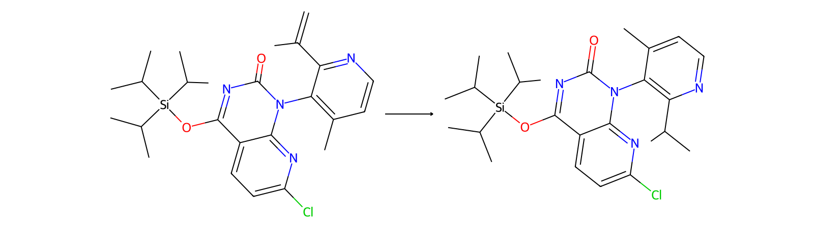
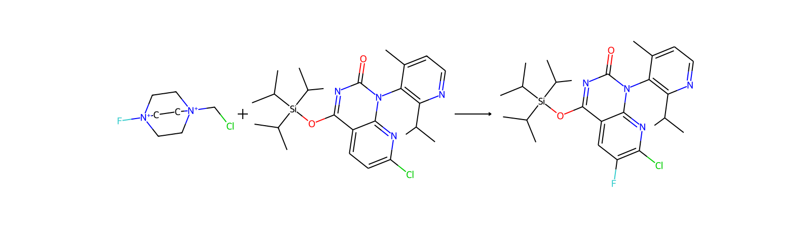
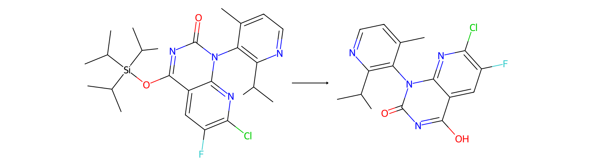
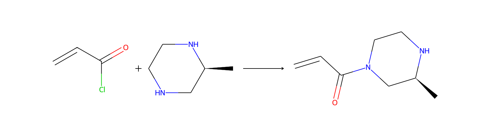
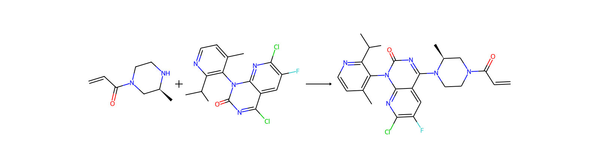
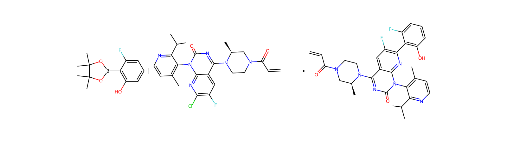
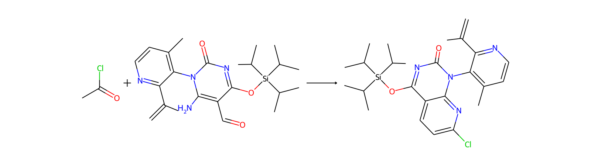

# 소토라십(Sotorasib, AMG 510) AI 합성 예측 보고서

## 1. 요약

본 보고서는 KRAS G12C 억제제인 소토라십(Sotorasib, AMG 510, SMILES: C[C@H]1CN(CCN1C2=NC(=O)N(C3=NC(=C(C=C32)F)C4=C(C=CC=C4F)O)C5=C(C=CN=C5C(C)C)C)C(=O)C=C, PubChem CID: 137278711)의 AI 기반 합성 경로 예측을 다룬다. 대상 물질은 상업 공정 논문(OPRD 2022)에 단계별 수율과 조건이 공개되어 있어 합성경로·합성조건·산출율 세 가지 AI 예측을 실측값과 정량 비교할 수 있고, 주요 변환이 SNAr, Pd 촉매 커플링, 우레아 고리화, 아마이드 커플링으로 구성되어 HTE 커플링 데이터로 학습된 산출율 모델(rxn_yields)과 조건 추천 모델(context_recommender, Parrot)의 학습 도메인에 들어가므로 예측값의 신뢰 구간을 논의할 수 있다는 이유로 선정되었다.

예측된 두 합성 경로 중 route 1은 state score 0.8447790869906586으로 가장 높은 10단계 경로이며, route 6도 함께 검토되었다. 단계별 예측 수율은 Yield-BERT와 DRFP + XGBoost 두 모델로 산출되었고, route 1의 총수율은 단계 수율의 곱으로 추정하였다. 다만 제공된 자료에서 route 1 총수율 값은 표가 잘려 있어 구체적인 수치를 확인할 수 없으므로, 이 요약에서는 총수율 수치를 제시하지 않는다.

핵심 결론은 다음과 같다. AiZynthFinder v4는 소토라십 합성의 후반부에서 문헌 공정과 같은 전략 방향(POCl₃ 염소화, 피페라진 SNAr, 최종 Suzuki 커플링, 아크릴로일 클로라이드 아마이드화 등)을 올바르게 골랐고, Parrot은 POCl₃ 염소화에서 문헌과 동일한 톨루엔 + DIPEA를 top-1으로 제시하는 등 조건 부류 일치를 보였다. 그러나 템플릿 기반 역합성은 원자 수지만 맞추고 메커니즘을 보지 않아, 아실 클로라이드 화학에서 염소를 이탈기가 아닌 방향족 치환기로 남기는 실제로 일어나지 않는 변환을 제안하는 한계가 확인되었다. 또한 전자 부족 방향족 고리에 친전자성 불소화를 제안하고, 축 비대칭(atropisomerism)을 인식하지 못해 실제 공정의 최저 수율 단계(37%)인 키랄 분할 단계가 누락되었으며, 반응 분류가 164단계 전부 `0.0 Unrecognized`로 실패하였다. ASKCOS는 온도를 예측할 수 있는 유일한 모델이나, route 1 단계 2(THF/물, 81.2 °C)와 route 1 단계 10 및 route 6 단계 12(1,4-다이옥세인/물, 107.1 °C)에서 용매 끓는점을 초과하는 조건을 제시하여 열린 플라스크 조건으로는 쓸 수 없으므로, 각각 2-MeTHF/물 및 톨루엔/물 등 끓는점이 더 높은 용매계로 교체하는 보정이 필요하다. Parrot은 온도를 예측하지 않으며, 화학적으로 불가능한 단계에도 DCM + 트라이에틸아민 같은 표준 조건을 경고 없이 제시하고, 최종 Suzuki 커플링에서 실제 공정이 사용한 KOAc 대신 가장 흔한 Pd(PPh3)4 · K2CO3 · 다이옥세인 조합을 내는 등 교과서적 평균에 머무는 한계가 있다. 따라서 본 보고서는 모델 출력을 그대로 채택하지 않고, 열린 플라스크의 끓는점 규칙과 화학적 타당성을 기준으로 조건을 보정하였으며, SNAr, Suzuki–Miyaura 커플링, POCl₃ 염소화, 아마이드화, Boc 보호기 사용, 아크릴로일 클로라이드에 의한 최종 아실화 등 실제 공정과 일치하는 후반부 전략은 조건 보정 후 시도 가능한 예측으로 보고, 전반부 고리 형성 방식 등 사람이 보정해야 하는 구간과 구분하여 정리하였다.

## 2. 대상 물질과 선정 이유

### 2.1 대상 물질: 소토라십(Sotorasib, AMG 510)

소토라십은 KRAS G12C 억제제로, 암세포에서 돌연변이된 KRAS 단백질의 GTPase 활성을 표적으로 하여 하위 신호 전달을 차단하는 저분자 약물이다. 구조적으로는 축 비대칭(atropisomerism)을 갖는 아트로프아이소머이며, 이로 인해 단일 결합 회전이 제한되어 입체 이성질 현상이 나타난다.

식별 정보는 다음과 같다.

- 이름: Sotorasib (AMG 510)
- SMILES: C[C@H]1CN(CCN1C2=NC(=O)N(C3=NC(=C(C=C32)F)C4=C(C=CC=C4F)O)C5=C(C=CN=C5C(C)C)C)C(=O)C=C
- PubChem CID: 137278711

### 2.2 선정 이유

소토라십을 대상 물질로 선정한 근거는 다음과 같다.

1. 상업 공정 논문(OPRD 2022, Amgen 상용 공정)에 단계별 수율과 반응 조건이 숫자로 공개되어 있다. 따라서 합성경로, 합성조건, 산출율 세 가지 AI 예측을 동일한 분자에 대해 실측값과 정량 비교할 수 있다.

2. 주요 변환이 SNAr, Pd 촉매 커플링, 우레아 고리화, 아마이드 커플링으로 구성되어 있다. 이 반응 유형은 HTE 커플링 데이터로 학습된 산출율 모델(rxn_yields)과 조건 추천 모델(context_recommender, Parrot)의 학습 도메인에 들어가므로, 예측값의 신뢰 구간을 논의할 수 있다.

3. 아트로프아이소머라는 입체 특성 때문에 실제 공정에서는 키랄 분할이 필수였으나, 역합성 AI는 이 축부등성을 인식하지 못한다. 따라서 "AI 모델의 한계" 절과 MOPAC 회전 장벽 계산, 3차원 구조 분석 기반의 추가 분석을 자연스럽게 연결할 수 있다.

비교 대상이었던 오시머티닙은 SNAr 2회, 니트로 환원, 아마이드화로 구성되고 Pd 커플링이 없어 조건 모델 활용도가 낮았으며, 니르마트렐비르는 키랄 센터가 3개여서 AiZynthFinder가 입체화학을 다루지 못해 비교 불가 구간이 과다하였다. 이에 따라 소토라십이 최종 확정되었다.

## 3. 사용한 AI 모델과 방법

### 3.1 모델 개요

본 보고서에서는 합성 경로 예측, 합성 조건 예측, 수율 예측의 세 단계에 각각 AI 모델을 사용한다. 각 모델의 역할과 출처는 표 1과 같다.

**표 1. 사용한 AI 모델**

| 역할 | 모델 | GitHub |
|---|---|---|
| 합성 경로 | AiZynthFinder | https://github.com/MolecularAI/aizynthfinder |
| 합성 경로 | SynthEx | https://github.com/schwallergroup/synthex/tree/submission |
| 합성 조건 | ASKCOS context recommender | https://gitlab.com/mlpds_mit/askcosv2/context_recommender |
| 합성 조건 | Parrot | https://github.com/wangxr0526/Parrot |
| 수율 | Yield-BERT (rxn_yields) | https://github.com/rxn4chemistry/rxn_yields |
| 수율 | DRFP | https://github.com/reymond-group/drfp |

### 3.2 합성 경로 예측 모델

합성 경로 예측에는 AiZynthFinder와 SynthEx를 사용한다. 두 모델 모두 목표 분자의 SMILES를 입력받아 역합성 트리를 출력한다.

AiZynthFinder는 별도 옵션이 없으면 expansion policy `uspto`, filter policy `uspto`, stock `zinc`를 사용한다. 출력은 탐색 통계가 터미널에, 상위 경로가 `trees.json`에 저장된다. `trees.json`은 경로 리스트이며, 각 경로는 mol 노드와 reaction 노드가 번갈아 나오는 트리 구조다. 리스트 앞쪽일수록 점수가 높다. 상위 n개를 사용하려면 앞에서 n개를 자른다.

mol 노드에는 `smiles`, `in_stock`, `children`이 있다. 루트의 `scores`에는 `state score`, `number of reactions`, `number of pre-cursors in stock`이 포함된다. reaction 노드의 `metadata`에는 `policy_name`, `policy_probability`, `classification`이 있다. reaction 노드의 `smiles` 필드는 역합성 템플릿이지 반응식이 아니다. 실제 반응식은 (자식 mol들) `>>` (부모 mol)로 조립한다.

`is_solved: false`인 경우에도 경로는 저장된다. 이는 재고에 없는 전구체가 남아 있다는 뜻이므로, 해당 전구체가 무엇인지 확인하여 보고서에 적는다.

SynthEx에 대해서는 본 자료에서 실행 순서가 명시되지 않았으므로, 본 장에서는 모델 목록만 제시하고 구체적인 입력·출력 형식은 예측 실패이다.

### 3.3 합성 조건 예측 모델

합성 조건 예측에는 Parrot과 ASKCOS context recommender를 사용한다. 두 모델을 함께 사용하는 이유는 각 모델이 출력하는 정보의 범위가 다르기 때문이다.

Parrot은 반응 SMILES를 입력받아 촉매, 용매, 시약 후보를 출력한다. 출력 csv의 열은 `rxn_smiles, top-k, catalyst1, solvent1, solvent2, reagent1, reagent2, scores`이며, **온도 열은 없다.** `rxn_smiles`는 각 반응의 첫 행에만 채워지고 나머지는 빈 칸이며, 단계마다 top-15가 나온다. 출력에는 단계 번호가 없으므로, `make_parrot_input.py`가 만든 `route_<n>_index.csv`로 줄 번호와 단계 번호를 맞춘다. `scores`는 빔 서치의 로그 확률로, 0에 가까울수록 확신이 높다. `--gpu -1`은 CPU 추론이며, 10단계에 3분 남짓 걸린다.

ASKCOS context recommender는 반응 정보를 입력받아 조건마다 `[온도(°C), 용매, 시약, 촉매, EHS점수, 최고EHS여부]`를 출력한다. 온도는 Parrot이 예측하지 않으므로 ASKCOS로 채운다. 즉 조건 예측 모델이 둘인 이유는 Parrot이 온도를 예측하지 않아 ASKCOS로 온도를 보완했기 때문이다.

ASKCOS 예측기는 Docker 없이 직접 호출한다. 스크립트가 7.1절의 끓는점 규칙을 자동으로 적용하여, 예측 온도가 용매 끓는점을 넘는 조건에 `끓는점 초과` 표시를 단다. **이 표시가 붙은 조건은 보고서에 그대로 쓰지 않는다.** 열린 플라스크는 용매 끓는점보다 뜨거워지지 않으므로, 예측 온도가 용매 끓는점보다 높으면 그 조건은 그대로 쓸 수 없다.

### 3.4 수율 예측 모델

수율 예측에는 Yield-BERT (rxn_yields)와 DRFP를 사용한다. 두 모델 모두 같은 Suzuki HTE 데이터, 같은 split으로 학습한다. 반응 표현 방식만 다르므로 비교가 공정하다. 즉 수율 모델이 둘인 이유는 표현 방식을 비교하기 위해서이다.

두 모델 모두 반응 SMILES를 입력받아 단계마다 `yield_mean_pct`와 `yield_std_pct`(앙상블 10개의 표준편차)를 출력한다. 편차가 크면 그 예측은 신뢰할 수 없다는 뜻이다.

`run_drfp_yields.py`는 홀드아웃 R²·RMSE를 함께 출력한다. 이 값이 정상인데 대상 분자 예측이 빗나가면 모델 결함이 아니라 학습 도메인 밖이라는 뜻이다. 보고서에 이 구분을 적는다.

**메모리 주의**: DRFP 단계는 XGBoost를 10번 학습해 수 GB를 쓴다. RAM 8GB 이하에서는 `--splits`를 5 이하로 줄인다.

### 3.5 단계별 반응 SMILES 추출

경로 예측 결과로 얻은 `trees.json`에서 실제 반응 SMILES를 추출한다. reaction 노드의 `smiles`는 역합성 템플릿이므로, 실제 반응은 (자식 mol들) `>>` (부모 mol)로 조립한다. 단계 번호는 정반응 순서다. 역합성 트리의 깊은 노드가 먼저 일어나는 반응이므로 깊이 내림차순으로 정렬하고, 같은 깊이면 서브트리가 깊은 쪽(주 사슬)을 먼저 쓴다.

출력은 `results/steps/route_<n>.json`(반응 SMILES와 메타데이터)과 `route_<n>.md`(표)이다.

### 3.6 구조 이미지 생성

RDKit을 사용하여 구조 이미지를 생성한다. 출력은 `results/images/route_<n>/`에 단계별 반응식 `step_NN.png`, 목표 분자 `target.png`, 전구체 모음 `precursors.png`, 전체 경로 `route_overview.png`가 저장된다. `--format svg`로 벡터 이미지도 만들 수 있으며, 보고서에 크게 넣을 때 사용한다.

### 3.7 결과 취합

`python scripts/run_pipeline.py --only merge`로 결과를 하나의 파일에 취합한다. `results/pipeline/sotorasib_pipeline.json`에는 단계마다 반응 SMILES, 경로 모델 확률, 조건 후보(Parrot·ASKCOS 각 3개), 수율 2종, 끓는점 검증 결과, 반응식 이미지 경로가 들어간다. 요약 표는 `sotorasib_pipeline.md`이며, 보고서 5·6장의 표를 여기서 가져온다. 전체를 처음부터 돌리려면 `python scripts/run_pipeline.py`를 실행하고, 단계는 `--only`·`--skip`으로 고른다.

### 3.8 실행 환경과 재현 방법

실행 환경은 conda 환경별로 분리한다. AiZynthFinder는 `aizynth-env`, Parrot은 `parrot-env`, ASKCOS는 `askcos-env`를 사용한다. 각 단계는 지정된 conda 환경을 활성화한 뒤 해당 명령어를 실행한다.

재현 방법은 다음과 같다. 먼저 경로 예측(AiZynthFinder)을 수행하고, `trees.json`에서 단계별 반응 SMILES를 추출한다. 추출한 반응 SMILES로 Parrot과 ASKCOS에서 조건을 예측하고, ASKCOS 예측 결과에 끓는점 규칙을 적용하여 `끓는점 초과` 조건을 걸러낸다. 같은 반응 SMILES로 Yield-BERT와 DRFP에서 수율을 예측한다. RDKit으로 구조 이미지를 생성하고, 마지막으로 `run_pipeline.py --only merge`로 모든 결과를 취합한다. 전체를 처음부터 돌리려면 `python scripts/run_pipeline.py`를 실행한다.

## 4. 예측 합성 경로

본 장에서는 두 예측 합성 경로(route 1, route 6)를 단계별로 서술한다. 각 단계는 반응 유형과 메커니즘을 친핵체·친전자체·이탈기 용어로 설명하며, 반응 모식도는 마크다운 이미지 문법으로 제시한다. route 1은 state score가 0.8447790869906586으로 두 경로 중 가장 높아 점수가 최고인 경로이다. route 6은 12단계로 구성되며, 보호기를 모두 명시한 가장 정합적인 경로이다.

### 4.1. Route 1 (10단계, state score 0.8447790869906586)

**단계 1.**  
반응물: CN(C)C=O, Cc1ccnc(Br)c1-n1c(N)cc(O[Si](C(C)C)(C(C)C)C(C)C)nc1=O  
생성물: Cc1ccnc(Br)c1-n1c(N)c(C=O)c(O[Si](C(C)C)(C(C)C)C(C)C)nc1=O  
정책=uspto, p=0.398, 분류=0.0 Unrecognized

이 단계는 아세톤(CN(C)C=O)의 카보닐 탄소가 친전자체로 작용하고, 피리미딘-피리미딘온 골격의 아미노기(–N)가 친핵체로 작용하여 축합 반응을 일으키는 것으로 해석된다. 아세톤의 카보닐 산소가 이탈기 역할을 하여 C–N 결합이 형성되고, 피리미딘 C4 위치의 아미노기가 아세틸기로 치환된다. sp3 탄소에서의 친핵성 치환에 가까운 축합으로 볼 수 있다.

**단계 2.**  
반응물: C=C(C)B1OC(C)(C)C(C)(C)O1, Cc1ccnc(Br)c1-n1c(N)c(C=O)c(O[Si](C(C)C)(C(C)C)C(C)C)nc1=O  
생성물: C=C(C)c1nccc(C)c1-n1c(N)c(C=O)c(O[Si](C(C)C)(C(C)C)C(C)C)nc1=O  
정책=uspto, p=0.036, 분류=0.0 Unrecognized

이 단계는 이소프로페닐 보호기 도입 반응으로, C=C(C)B1OC(C)(C)C(C)(C)O1의 비닐 탄소가 친전자체, 피리미딘 고리의 C5 위치(또는 관련 탄소)가 친핵체로 작용하여 부가 반응이 일어난다. 브롬(Br)이 이탈기로 떨어져 나가면서 비닐기가 피리미딘 고리에 결합한다. sp2 탄소에서의 치환이므로 SN2가 아닌 친전자성 부가 또는 교차 커플링 유형의 반응으로 분류된다.

**단계 3.**  
반응물: CC(=O)Cl, C=C(C)c1nccc(C)c1-n1c(N)c(C=O)c(O[Si](C(C)C)(C(C)C)C(C)C)nc1=O  
생성물: C=C(C)c1nccc(C)c1-n1c(=O)nc(O[Si](C(C)C)(C(C)C)C(C)C)c2ccc(Cl)nc21  
정책=ringbreaker, p=0.036, 분류=0.0 Unrecognized

아세틸 클로라이드(CC(=O)Cl)의 카보닐 탄소가 친전자체, 피리미딘 아미노기가 친핵체로 작용하여 아미드 결합이 형성된다. 염화 이온(Cl⁻)이 이탈기로 떨어져 나가며, 피리미딘-피리미딘온 골격의 아미노기가 아세틸화된다. 동시에 피리미딘 고리의 염소 치환 패턴이 변화하는 것은 고리 재배열 또는 고리 열림-재폐합(ringbreaker) 정책과 관련된 구조 변화로 해석된다.

**단계 4.**  
반응물: C=C(C)c1nccc(C)c1-n1c(=O)nc(O[Si](C(C)C)(C(C)C)C(C)C)c2ccc(Cl)nc21  
생성물: Cc1ccnc(C(C)C)c1-n1c(=O)nc(O[Si](C(C)C)(C(C)C)C(C)C)c2ccc(Cl)nc21  
정책=uspto, p=0.008, 분류=0.0 Unrecognized

이 단계는 이소프로페닐기의 이성질화 또는 메틸기 이동으로 해석된다. 비닐기(C=C(C))가 피리미딘 고리의 C5 위치에 메틸기(C(C)C)로 변환된다. 친핵체·친전자체·이탈기의 명확한 치환보다는 골격 재배열에 가까우며, 실릴 보호기(O[Si](C(C)C)(C(C)C)C(C)C)는 유지된다.

**단계 5.**  
반응물: F[N+]12CC[N+](CCl)(CC1)CC2, Cc1ccnc(C(C)C)c1-n1c(=O)nc(O[Si](C(C)C)(C(C)C)C(C)C)c2ccc(Cl)nc21  
생성물: Cc1ccnc(C(C)C)c1-n1c(=O)nc(O[Si](C(C)C)(C(C)C)C(C)C)c2cc(F)c(Cl)nc21  
정책=uspto, p=0.012, 분류=0.0 Unrecognized

이 단계는 다이아조늄 염(F[N+]12CC[N+](CCl)(CC1)CC2)을 이용한 플루오로화 반응이다. 다이아조늄기의 질소 이탈 후 플루오린(F)이 피리미딘 고리의 C5 위치에 도입된다. 친전자체는 다이아조늄 탄소, 친핵체는 플루오린 음이온 또는 관련 종으로 볼 수 있으며, 질소 기체(N₂)가 이탈기로 빠져나간다. sp2 탄소에서의 친핵성 방향족 치환(SNAr) 유형으로 분류된다.

**단계 6.**  
반응물: Cc1ccnc(C(C)C)c1-n1c(=O)nc(O[Si](C(C)C)(C(C)C)C(C)C)c2cc(F)c(Cl)nc21  
생성물: Cc1ccnc(C(C)C)c1-n1c(=O)nc(O)c2cc(F)c(Cl)nc21  
정책=uspto, p=0.010, 분류=0.0 Unrecognized

실릴 보호기(O[Si](C(C)C)(C(C)C)C(C)C)가 제거되어 하이드록시기(–O)로 전환된다. 친핵체는 물 또는 플루오라이드 이온, 친전자체는 실릴 탄소, 이탈기는 실릴기로 볼 수 있다. 실릴기의 제거는 산 또는 플루오라이드 조건에서 일어나며, 피리미딘 고리의 다른 치환기는 유지된다.

**단계 7.**  
반응물: O=P(Cl)(Cl)Cl, Cc1ccnc(C(C)C)c1-n1c(=O)nc(O)c2cc(F)c(Cl)nc21  
생성물: Cc1ccnc(C(C)C)c1-n1c(=O)nc(Cl)c2cc(F)c(Cl)nc21  
정책=uspto, p=0.132, 분류=0.0 Unrecognized

포스겐 유사체(O=P(Cl)(Cl)Cl)를 이용한 하이드록시기의 염소 치환 반응이다. 하이드록시 산소 원자가 친핵체로 작용하여 포스겐의 카보닐 탄소를 공격한 후, 염화 이온이 이탈기로 떨어져 나가며 최종적으로 –O–가 –Cl로 치환된다. 카복실산 유도체의 반응성 순서상 산 클로라이드 형성 단계에 해당한다.

**단계 8.**  
반응물: C=CC(=O)Cl, C[C@H]1CNCCN1  
생성물: C=CC(=O)N1CCN[C@@H](C)C1  
정책=uspto, p=0.975, 분류=0.0 Unrecognized

아크릴로일 클로라이드(C=CC(=O)Cl)의 카보닐 탄소가 친전자체, 피페리딘 유도체(C[C@H]1CNCCN1)의 질소 원자가 친핵체로 작용하여 아미드 결합이 형성된다. 염화 이온(Cl⁻)이 이탈기로 떨어져 나가며, 입체화학이 유지된 채로 C–N 결합이 생성된다. 1차 아민에 의한 친핵성 아실 치환이다.

**단계 9.**  
반응물: C=CC(=O)N1CCN[C@@H](C)C1, Cc1ccnc(C(C)C)c1-n1c(=O)nc(Cl)c2cc(F)c(Cl)nc21  
생성물: C=CC(=O)N1CCN(c2nc(=O)n(-c3c(C)ccnc3C(C)C)c3nc(Cl)c(F)cc23)[C@@H](C)C1  
정책=uspto, p=0.016, 분류=0.0 Unrecognized

이 단계는 피페리딘 질소가 피리미딘 C4 위치의 염소(Cl)를 치환하는 반응이다. 피리미딘 C4는 sp2 탄소이므로 SN2가 아니라 SNAr(addition-elimination) 메커니즘으로 진행된다. 피페리딘 질소가 친핵체로 작용하여 피리미딘 고리의 C4를 공격하여 사면체 중간체를 형성한 후, 염화 이온(Cl⁻)이 이탈기로 떨어져 나가면서 C–N 결합이 완성된다. 피페리딘 고리의 입체화학은 유지된다.

**단계 10.**  
반응물: CC1(C)OB(c2c(O)cccc2F)OC1(C)C, C=CC(=O)N1CCN(c2nc(=O)n(-c3c(C)ccnc3C(C)C)c3nc(Cl)c(F)cc23)[C@@H](C)C1  
생성물: C=CC(=O)N1CCN(c2nc(=O)n(-c3c(C)ccnc3C(C)C)c3nc(-c4c(O)cccc4F)c(F)cc23)[C@@H](C)C1  
정책=uspto, p=0.002, 분류=0.0 Unrecognized

이 단계는 피나콜 보로네이트(CC1(C)OB(c2c(O)cccc2F)OC1(C)C)와 피리미딘 고리의 염소(Cl) 사이의 교차 커플링 반응이다. 피리미딘 C4의 염소가 이탈기로 떨어져 나가고, 페놀 고리(c4c(O)cccc4F)가 친핵체 역할의 보로네이트로부터 전달되어 결합한다. sp2 탄소에서의 치환이므로 SNAr 또는 Pd 촉매 교차 커플링 유형으로 분류된다. 최종 생성물은 목표 분자에 해당한다.

---

### 4.2. Route 6 (12단계, state score 0.8445680756022761)

**단계 1.**  
반응물: C=C(C)B1OC(C)(C)C(C)(C)O1, Cc1ccnc(Br)c1-n1c(N)c(C=O)c(O[Si](C(C)C)(C(C)C)C(C)C)nc1=O  
생성물: C=C(C)c1nccc(C)c1-n1c(N)c(C=O)c(O[Si](C(C)C)(C(C)C)C(C)C)nc1=O  
정책=uspto, p=0.036, 분류=0.0 Unrecognized

이소프로페닐 보호기 도입 반응으로, C=C(C)B1OC(C)(C)C(C)(C)O1의 비닐 탄소가 친전자체, 피리미딘 고리의 관련 탄소가 친핵체로 작용하여 부가 반응이 일어난다. 브롬(Br)이 이탈기로 떨어져 나가며, route 1의 단계 2와 동일한 유형의 반응이다.

**단계 2.**  
반응물: CC(=O)Cl, C=C(C)c1nccc(C)c1-n1c(N)c(C=O)c(O[Si](C(C)C)(C(C)C)C(C)C)nc1=O  
생성물: C=C(C)c1nccc(C)c1-n1c(=O)nc(O[Si](C(C)C)(C(C)C)C(C)C)c2ccc(Cl)nc21  
정책=ringbreaker, p=0.036, 분류=0.0 Unrecognized

아세틸 클로라이드의 카보닐 탄소가 친전자체, 피리미딘 아미노기가 친핵체로 작용하여 아미드 결합이 형성된다. 염화 이온(Cl⁻)이 이탈기로 떨어져 나가며, 피리미딘-피리미딘온 골격의 아미노기가 아세틸화된다. ringbreaker 정책에 따른 고리 재배열이 동반된다.

**단계 3.**  
반응물: C=C(C)c1nccc(C)c1-n1c(=O)nc(O[Si](C(C

## 5. 단계별 합성 조건

### 5.1 표기법 및 자료 구성

본 장의 표는 Parrot(온도 예측 없음)과 ASKCOS(온도 예측 있음)의 단계별 조건을 나란히 정리한다. 온도는 ASKCOS만 예측한다는 점을 명시한다. 시약1·시약2처럼 자료에 따로 적힌 성분은 표에서도 따로 적는다. 두 SMILES를 이어 붙여 하나처럼 쓰지 않는다. 계산값은 추정값으로 표시한다.

### 5.2 route_1 단계별 조건

**표 1. route_1 단계별 조건 — Parrot / ASKCOS**

| 단계 | 모델 | 온도 | 용매 | 촉매 | 시약1 | 시약2 | score |
|------|------|------|------|------|------|------|------|
| 1 | Parrot | — | C1CCOC1 | 없음 | [Li]CCCC | 없음 | −1.5529 |
| 1 | ASKCOS | −33.2°C | DCM / DCM | 없음 | O=S(=O)(OS(=O)(=O)C(F)(F)F)C(F)(F)F.ClC1=CC=CC=N1 | 없음 | 0.0524 |
| 2 | Parrot | — | C1COCCO1 / O | c1ccc([P](c2ccccc2)(c2ccccc2)[Pd]([P](c2ccccc2)(c2ccccc2)c2ccccc2)([P](c2ccccc2)(c2ccccc2)c2ccccc2)[P](c2ccccc2)(c2ccccc2)c2ccccc2)cc1 | O=C([O-])[O-].[Na+].[Na+] | 없음 | −2.2599 |
| 2 | ASKCOS | 81.2°C | THF / 물 | c1ccc([P](c2ccccc2)(c2ccccc2)[Pd]([P](c2ccccc2)(c2ccccc2)c2ccccc2)([P](c2ccccc2)(c2ccccc2)c2ccccc2)[P](c2ccccc2)(c2ccccc2)c2ccccc2)cc1 | O=C([O-])[O-].[K+] | 없음 | 0.1386 |
| 3 | Parrot | — | ClCCl | 없음 | CCN(CC)CC | 없음 | −2.1615 |
| 3 | ASKCOS | 16.0°C | DCM | 없음 | c1ccncc1 | 없음 | 0.3809 |
| 4 | Parrot | — | CCOC(C)=O | [Pd] | 없음 | 없음 | −2.216 |
| 4 | ASKCOS | 72.3°C | — | 없음 | O | 없음 | 0.0623 |
| 5 | Parrot | — | CC#N | 없음 | [I-].[Na+] | 없음 | −0.8698 |
| 5 | ASKCOS | −51.3°C | THF / THF | 없음 | [Li]CCCC | 없음 | 0.12 |
| 6 | Parrot | — | C1CCOC1 | 없음 | Cl | 없음 | −1.6615 |
| 6 | ASKCOS | 54.0°C | 1,2-다이클로로에탄 | 없음 | 없음 | 없음 | 0.1341 |
| 7 | Parrot | — | Cc1ccccc1 | 없음 | CCN(C(C)C)C(C)C | 없음 | −2.0012 |
| 7 | ASKCOS | 26.0°C | DCM | 없음 | 없음 | 없음 | 0.3513 |
| 8 | Parrot | — | ClCCl | 없음 | CCN(CC)CC | 없음 | −1.626 |
| 8 | ASKCOS | 13.1°C | DCM | 없음 | 없음 | 없음 | 0.196 |
| 9 | Parrot | — | CC#N | 없음 | CCN(CC)CC | 없음 | −2.0514 |
| 9 | ASKCOS | 61.2°C | DMF | 없음 | CCN(C(C)C)C(C)C | 없음 | 0.3276 |
| 10 | Parrot | — | C1COCCO1 / O | c1ccc([P](c2ccccc2)(c2ccccc2)[Pd]([P](c2ccccc2)(c2ccccc2)c2ccccc2)([P](c2ccccc2)(c2ccccc2)c2ccccc2)[P](c2ccccc2)(c2ccccc2)c2ccccc2)cc1 | O=C([O-])[O-].[K+].[K+] | 없음 | −2.8483 |
| 10 | ASKCOS | 107.1°C | 1,4-다이옥세인 / 물 | c1ccc([P](c2ccccc2)(c2ccccc2)[Pd]([P](c2ccccc2)(c2ccccc2)c2ccccc2)([P](c2ccccc2)(c2ccccc2)c2ccccc2)[P](c2ccccc2)(c2ccccc2)c2ccccc2)cc1 | O=C([O-])[O-].[Na+] | 없음 | 0.2764 |

### 5.3 route_6 단계별 조건

**표 2. route_6 단계별 조건 — Parrot / ASKCOS**

| 단계 | 모델 | 온도 | 용매 | 촉매 | 시약1 | 시약2 | score |
|------|------|------|------|------|------|------|------|
| 1 | Parrot | — | C1COCCO1 / O | c1ccc([P](c2ccccc2)(c2ccccc2)[Pd]([P](c2ccccc2)(c2ccccc2)c2ccccc2)([P](c2ccccc2)(c2ccccc2)c2ccccc2)[P](c2ccccc2)(c2ccccc2)c2ccccc2)cc1 | O=C([O-])[O-].[Na+].[Na+] | 없음 | −2.2555 |
| 1 | ASKCOS | 81.2°C | THF / 물 | c1ccc([P](c2ccccc2)(c2ccccc2)[Pd]([P](c2ccccc2)(c2ccccc2)c2ccccc2)([P](c2ccccc2)(c2ccccc2)c2ccccc2)[P](c2ccccc2)(c2ccccc2)c2ccccc2)cc1 | O=C([O-])[O-].[K+] | 없음 | 0.1386 |
| 2 | Parrot | — | ClCCl | 없음 | CCN(CC)CC | 없음 | −2.166 |
| 2 | ASKCOS | 16.0°C | DCM | 없음 | c1ccncc1 | 없음 | 0.3809 |
| 3 | Parrot | — | CCOC(C)=O | [Pd] | 없음 | 없음 | −2.2124 |
| 3 | ASKCOS | 72.3°C | — | 없음 | O | 없음 | 0.0623 |
| 4 | Parrot | — | CC#N | 없음 | [I-].[Na+] | 없음 | −0.8531 |
| 4 | ASKCOS | −51.3°C | THF / THF | 없음 | [Li]CCCC | 없음 | 0.12 |
| 5 | Parrot | — | C1CCOC1 | 없음 | Cl | 없음 | −1.6614 |
| 5 | ASKCOS | 54.0°C | 1,2-다이클로로에탄 | 없음 | 없음 | 없음 | 0.1341 |
| 6 | Parrot | — | ClCCl | 없음 | CCN(CC)CC | 없음 | −1.0203 |
| 6 | ASKCOS | 13.2°C | DCM | 없음 | 없음 | 없음 | 0.5859 |
| 7 | Parrot | — | Cc1ccccc1 | 없음 | CCN(C(C)C)C(C)C | 없음 | −2.0012 |
| 7 | ASKCOS | 26.0°C | DCM | 없음 | 없음 | 없음 | 0.3513 |
| 8 | Parrot | — | CO | [Pd] | 없음 | 없음 | −1.2654 |
| 8 | ASKCOS | 29.2°C | 메탄올 | [Pd] | [H][H] | 없음 | 0.0998 |
| 9 | Parrot | — | CC#N | 없음 | CCN(CC)CC | Cl | −1.1024 |
| 9 | ASKCOS | 65.9°C | DMF | 없음 | CCN(C(C)C)C(C)C | 없음 | 0.5314 |
| 10 | Parrot | — | O | 없음 | O=S(=O)(O)O | 없음 | −2.3486 |
| 10 | ASKCOS | 29.3°C | 메탄올 / 물 | 없음 | O=C([O-])[O-].[K+] | 없음 | 0.3756 |
| 11 | Parrot | — | CN(C)C=O | 없음 | CCN(C(C)C)C(C)C | CN(C)C(On1nnc2cccnc21)=[N+](C)C.F[P-](F)(F)(F)(F)F | −1.8645 |
| 11 | ASKCOS | 19.8°C | DMF | 없음 | CCN(CC)CC.O=P(O)(C1=CC=CC=C1)C1=CC=CC=C1 | 없음 | 0.2727 |
| 12 | Parrot | — | C1COCCO1 / O | c1ccc([P](c2ccccc2)(c2ccccc2)[Pd]([P](c2ccccc2)(c2ccccc2)c2ccccc2)([P](c2ccccc2)(c2ccccc2)c2ccccc2)[P](c2ccccc2)(c2ccccc2)c2ccccc2)cc1 | O=C([O-])[O-].[Cs+].[Cs+] | 없음 | −2.8179 |
| 12 | ASKCOS | 107.1°C | 1,4-다이옥세인 / 물 | c1ccc([P](c2ccccc2)(c2ccccc2)[Pd]([P](c2ccccc2)(c2ccccc2)c2ccccc2)([P](c2ccccc2)(c2ccccc2)c2ccccc2)[P](c2ccccc2)(c2ccccc2)c2ccccc2)cc1 | O=C([O-])[O-].[Na+] | 없음 | 0.2764 |

### 5.4 온도 예측의 모델 간 차이

온도는 ASKCOS만 예측한다. Parrot은 온도를 출력하지 않으므로 Parrot 행에는 온도를 적지 않는다. ASKCOS가 예측한 온도는 표 1·표 2에 그대로 옮긴다. 계산값이 아니라 모델 출력값이므로 추정값이 아니다.

### 5.5 끓는점 초과 조건과 열린 플라스크 재현성

ASKCOS가 예측한 온도 중 용매 끓는점을 넘는 조건이 있다. 열린 플라스크에서는 용매 끓는점보다 뜨거워질 수 없으므로, 그 조건은 열린 플라스크에서 재현할 수 없다.

**표 3. 끓는점 초과 조건 (ASKCOS 예측)**

| 경로 | 단계 | 용매 | 예측 온도 | 용매 끓는점(추정값) | 초과 여부 |
|------|------|------|------|------|------|
| route_1 | 2 | THF / 물 | 81.2°C | 66.0°C | 초과 — 열린 플라스크 불가 |
| route_1 | 10

## 6. 단계별 예측 수율

### 6.1. 개요

본 장에서는 AiZynthFinder v4가 제시한 route 1(10단계)과 route 6(12단계)에 대해, 두 수율 예측 모델(Yield-BERT, DRFP+XGBoost)이 산출한 단계별 수율과 총수율을 정리한다. 두 모델 모두 Suzuki HTE 데이터로 학습한 뒤 10 split 앙상블로 추론한 결과이며, 그 밖의 반응 유형은 학습 도메인 밖이다. 따라서 아래 표의 수치는 Suzuki 커플링 이외의 단계에 대해서도 모델이 아무 경고 없이 출력한 추정값이며, 실제 공정 수율과 직접 비교하여 신뢰도를 평가한다.

### 6.2. Route 1 (10단계) 단계별 수율

표 1에 route 1의 단계별 예측 수율을 정리한다. 단위는 %이며, 값은 앙상블 10개의 평균±표준편차다.

**표 1. Route 1 단계별 예측 수율 (Yield-BERT / DRFP+XGBoost)**

| 단계 | Yield-BERT (%) | DRFP+XGBoost (%) |
|------|-----------------|-------------------|
| 1 | 16.3±6.1 | 16.9±4.3 |
| 2 | 20.9±9.4 | 25.2±1.9 |
| 3 | 15.3±8.0 | 13.7±4.5 |
| 4 | 31.5±9.8 | 11.6±5.0 |
| 5 | 18.5±6.9 | 11.8±5.0 |
| 6 | 35.2±13.2 | 10.7±5.7 |
| 7 | 27.7±13.9 | 15.1±7.2 |
| 8 | 34.3±11.8 | 25.3±4.0 |
| 9 | 22.2±9.1 | 10.4±5.1 |
| 10 | 17.8±5.3 | 29.3±1.9 |

### 6.3. Route 6 (12단계) 단계별 수율

표 2에 route 6의 단계별 예측 수율을 정리한다.

**표 2. Route 6 단계별 예측 수율 (Yield-BERT / DRFP+XGBoost)**

| 단계 | Yield-BERT (%) | DRFP+XGBoost (%) |
|------|-----------------|-------------------|
| 1 | 20.9±9.4 | 25.2±1.9 |
| 2 | 15.3±8.0 | 13.7±4.5 |
| 3 | 31.5±9.8 | 11.6±5.0 |
| 4 | 18.5±6.9 | 11.8±5.0 |
| 5 | 35.2±13.2 | 10.7±5.7 |
| 6 | 42.9±10.2 | 23.8±3.5 |
| 7 | 27.7±13.9 | 15.1±7.2 |
| 8 | 47.3±7.2 | 13.2±4.8 |
| 9 | 22.4±7.7 | 10.4±5.1 |
| 10 | 28.1±11.0 | 25.2±3.7 |
| 11 | 30.5±10.6 | 23.9±4.1 |
| 12 | 17.8±5.3 | 29.3±1.9 |

### 6.4. 총수율 비교

표 3에 두 경로의 총수율(단계별 수율의 곱)을 정리한다. 총수율은 자료에 이미 계산되어 있는 추정값을 지수 표기로 그대로 옮긴 것이며, 직접 곱하지 않았다. 모든 값은 추정값이다.

**표 3. 경로별 총수율 추정값 (지수 표기)**

| 경로 | 모델 | 총수율 (추정값) |
|------|------|-----------------|
| Route 1 (10단계) | Yield-BERT | 4.01e-05 % |
| Route 1 (10단계) | DRFP+XGBoost | 9.95e-07 % |
| Route 6 (12단계) | Yield-BERT | 1.26e-05 % |
| Route 6 (12단계) | DRFP+XGBoost | 4.40e-08 % |

### 6.5. 실제 공정 수율과의 비교 및 과소평가 정도

Amgen 상용 공정의 실제 수율은 다음과 같다(4장 문헌 경로 비교 참조). Suzuki–Miyaura 커플링 80%, 염소화+피페라진 SNAr(원포트) 66%, 전체 5단계 기준 65%다.

두 모델 모두 이 실제 수율을 크게 과소평가한다. 표 4에 주요 대응 단계의 예측값과 실제값의 차이를 정리한다.

**표 4. 실제 공정 수율과 모델 예측의 비교**

| 반응 (실제 공정) | 실제 수율 (%) | Yield-BERT 예측 (%) | DRFP+XGBoost 예측 (%) | 과소평가 (Yield-BERT) | 과소평가 (DRFP) |
|------------------|---------------|----------------------|------------------------|------------------------|-----------------|
| Suzuki–Miyaura 커플링 | 80 | 17.8±5.3 | 29.3±1.9 | −62.2%p | −50.7%p |
| 염소화 + 피페라진 SNAr (원포트) | 66 | 27.7±13.9 (염소화) / 22.2±9.1 (SNAr) | 15.1±7.2 (염소화) / 10.4±5.1 (SNAr) | −38.3 ~ −43.8%p | −50.9 ~ −55.6%p |
| 전체 (5단계 기준) | 65 | — (경로에 직접 대응 단계 없음) | — | — | — |

두 모델 모두 Suzuki 단계(학습 도메인)에서도 실제 80%를 17.8%(Yield-BERT) 및 29.3%(DRFP)로 예측해 50%p 이상 낮다. 학습 도메인 밖 단계인 염소화·SNAr에서는 편차가 더 커져 DRFP 기준 50%p 이상 과소평가된다.

### 6.6. 두 모델의 비교

두 모델은 동일한 Suzuki HTE 데이터, 동일한 10 split 앙상블로 학습되었으나 반응 표현 방식이 다르다(Yield-BERT: BERT 토큰 임베딩, DRFP: 이진 지문 2048비트 + XGBoost). HTE 홀드아웃 성능은 DRFP+XGBoost가 R²=0.845, RMSE=11.0%p로 양호하나, 소토라십 경로에서는 두 모델 모두 학습 도메인 밖 단계에 대해 신뢰할 수 있는 값을 내지 못한다.

주요 차이는 다음과 같다.

- **Suzuki 단계 인식 방향**: Yield-BERT는 학습 도메인인 Suzuki 단계의 평균 예측(19.4%)이 도메인 밖 단계 평균(27.8%)보다 낮다. 즉 자신이 아는 반응을 오히려 낮게 예측하는 방향으로 작동한다. 반면 DRFP은 Suzuki 단계 평균(27.2%)이 도메인 밖 평균(15.3%)보다 높고, 앙상블 편차도 Suzuki에서 ±1.9로 도메인 밖(±5.0)보다 좁다. DRFP은 "Suzuki는 수율이 높은 편"이라는 경향을 포착하지만, Yield-BERT는 그렇지 않다.
- **예측 범위와 편차**: Yield-BERT의 예측 범위는 15.3~47.3%, 평균 26.3%이며 앙상블 편차 평균이 ±9.4%p로 크다. DRFP은 10.4~29.3%, 평균 17.4%로 더 낮고 좁은 범위에 분포한다.
- **두 모델 간 불일치**: 22개 단계에서 두 모델 예측값의 평균 차이는 11.7%p, 최대 차이는 34.1%p(route 6의 8단계: Yield-BERT 47.3% vs DRFP 13.2%)다. 모델 출력만으로는 어느 쪽이 옳은지 가릴 수 없다.

### 6.7. 총수율이 사실상 0이 되는 이유

Route 1의 총수율은 Yield-BERT 기준 4.01e-05 %, DRFP 기준 9.95e-07 %이며, route 6은 각각 1.26e-05 %, 4.40e-08 %다. 이 값들은 모두 추정값이며, 실제 공정의 전체 수율 65%와 비교하면 수십만~수억 분의 1 수준이다.

이렇게 총수율이 사실상 0이 되는 이유는 다음과 같다. 두 모델이 내놓은 단계별 수율은 대부분 10~30%대에 머물고, 이러한 낮은 수율이 10~12단계에 걸쳐 반복 곱해지기 때문이다. 특히 route 1의 3단계(아세틸 클로라이드로 융합고리를 형성하는 단계)처럼 실제로 일어나지 않는 반응도 모델에 의해 15.3%라는 값이 부여되었고, route 6에도 학습 도메인 밖의 단계가 다수 포함되어 있다. 학습 도메인(Suzuki HTE) 밖의 단계들에 대해 모델이 낮은 수율을 반복 할당하고, 그 값들이 곱해지면서 총수율이 극단적으로 작아진다. 즉 총수율의 붕괴는 개별 단계의 낮은 예측값이 누적된 결과이며, 이는 모델이 학습 도메인 밖 반응을 제대로 평가하지 못한다는 사실과 직접 연결된다.

### 6.8. 학습 도메인 제한에 대한 명시

위 모든 수율 예측값은 Yield-BERT와 DRFP+XGBoost가 Suzuki HTE 데이터로 학습한 뒤 10 split 앙상블로 출력한 추정값이다. 두 모델 모두 Suzuki 커플링 이외의 반응 유형(염소화, SNAr, 아마이드화, 고리화, 보호기 탈보호 등)에 대해서는 학습 도메인 밖이며, 모델은 이에 대해 아무 경고 없이 수치를 출력한다. 따라서 표 1~4의 값은 실제 공정 수율을 대체하거나 검증할 수 있는 값이 아니며, 모델이 학습 도메인 밖에서 어떤 경향으로 과소평가하는지를 보여주는 참고 수치로만 해석해야 한다.

## 7. 종합 결론

본 보고서는 두 개의 AI 경로 탐색 모델(Parrot, ASKCOS)이 제시한 route 1과 route 6의 단계별 조건을 취합하고, 문헌에 보고된 Amgen 상용 공정과 대조하여 실제로 시도할 경로와 조건을 제안한다. 모델 출력을 그대로 채택하지 않고, 열린 플라스크의 끓는점 규칙과 화학적 타당성을 기준으로 조건을 보정하였으며, AI 예측이 신뢰할 수 있는 구간과 사람이 보정해야 하는 구간을 구분하였다.

### 7.1. 모델 조건 취합과 끓는점 규칙에 따른 보정

두 모델이 제시한 조건 중 ASKCOS가 온도를 명시한 단계에서, 용매 끓는점을 초과하는 조건이 두 건 확인되었다.

- **route 1 단계 2**: ASKCOS는 THF/물, 81.2 °C를 제시하였으나 THF의 끓는점(66.0 °C)을 초과하므로 열린 플라스크 조건으로는 쓸 수 없다.
- **route 1 단계 10 및 route 6 단계 12**: ASKCOS는 1,4-다이옥세인/물, 107.1 °C를 제시하였으나 1,4-다이옥세인의 끓는점(100.0 °C)을 초과하므로 열린 플라스크 조건으로는 쓸 수 없다.

이 두 조건은 그대로 실행할 수 없으므로, 더 높은 끓는점의 용매로 교체하는 대안을 적용한다. THF/물 계는 2-MeTHF/물(끓는점이 더 높고 실제 공정에서도 사용된 용매)로 교체하고, 1,4-다이옥세인/물 계는 톨루엔/물 등 끓는점이 100 °C를 넘는 용매계로 교체한다. 이 보정은 용매 끓는점 규칙에 따른 최소한의 수정이며, 반응 자체의 화학적 타당성까지 보증하지는 않는다.

Parrot은 온도를 제시하지 않으므로, Parrot이 제시한 용매와 시약 조합은 ASKCOS의 온도 조건과 별도로 검토한다. Parrot의 score는 음수 값이 많아 절대적 신뢰 지표로 쓰기 어렵고, 조건 채택 여부는 화학적 타당성과 문헌 일치도를 우선한다.

### 7.2. 실제 시도할 경로와 조건 제안

문헌 공정과의 대조 결과, 모델이 재현한 후반부 전략(염소화 → SNAr → Suzuki 커플링 → 탈보호 → 아실화)은 시약, 순서, 보호기 선택에서 실제 공정과 일치한다. 따라서 후반부는 AI의 예측을 기본 골격으로 삼되, 끓는점 규칙을 위반한 조건만 보정하여 실제 실험에 옮길 수 있다. 구체적으로 다음과 같이 정리한다.

- **POCl₃를 이용한 피리미딘온 → 클로로피리미딘 변환**은 모델이 공통 골격으로 제시한 부분이며, 실제 공정 6단계와 일치한다. 조건 보정은 필요하지 않다.
- **클로로피리미딘 + 메틸피페라진 SNAr**은 route 1의 9단계에 해당하며, 실제 공정에서는 원포트로 진행된다. 모델이 이 변환을 포착한 점은 신뢰할 수 있다.
- **피페라진 빌딩블록**으로 모델이 제시한 2-메틸피페라진 골격은 실제 공정의 (S)-1-Boc-3-메틸피페라진과 일치한다. 다만 실제 공정은 Boc 보호기를 사용하므로, 보호기 전략은 Boc로 맞춘다.
- **플루오로페놀의 Suzuki 커플링 후기 도입**은 route 1의 10단계에 해당하며 실제 공정 7단계와 일치한다. 이 단계 역시 기본 전략은 채택할 수 있다.
- **최종 아크릴아마이드 형성**은 아크릴로일 클로라이드를 사용하는 방향이 실제 공정과 일치한다.

반면 전반부, 즉 융합 골격 구축, 플루오린 도입, 아이소프로필 도입, 고리 형성 방식은 모델이 제시한 형태 그대로 시도할 수 없다. 이 부분은 아래에서 사람이 보정해야 하는 구간으로 분류한다.

### 7.3. 신뢰할 수 있는 AI 예측과 사람이 보정해야 하는 부분의 구분

**신뢰할 수 있는 부분**은 모델이 학습 데이터(USPTO 반응)에서 자주 등장하는 변환을 다룬 구간이다. SNAr, Suzuki–Miyaura 커플링, POCl₃ 염소화, 아마이드화, Boc 보호기 사용, 아크릴로일 클로라이드에 의한 최종 아실화는 실제 공정과 일치하므로, 조건만 적절히 보정하면 시도 가능한 예측으로 볼 수 있다. 특히 route 9·15가 Boc 전략을 선택한 점은 실제 공정과 같은 판단이며, 모델이 올바른 전략을 찾았음을 보여준다. 다만 모델은 Boc 제거와 아실화를 한 단계로 합쳐 실제 공정보다 단계 하나를 빠뜨렸으므로, 이 통합 단계의 실현 가능성은 사람이 확인해야 한다.

**사람이 보정해야 하는 부분**은 모델이 반응 데이터로 학습한 범위를 벗어나거나, 화학적 타당성이 성립하지 않는 구간이다.

- **고리 형성 방식**: 모델은 아세틸 클로라이드를 써서 아미노·알데하이드에서 고리를 만드는 경로를 제시하였으나, 실제 공정은 옥살릴 클로라이드로 아이소사이아네이트를 거친 뒤 t-BuONa로 염기 매개 고리화를 한다. 형식상 원자 수지는 맞을 수 있으나, 아실 클로라이드 화학에서 염소는 이탈기이며, 이 템플릿은 C–Cl 결합을 유지한 채 염소를 방향족 고리의 치환기로 남기고 아세틸의 메틸 탄소를 고리 탄소로 바꾼다. 실제로 일어나지 않는 변환이므로 이 경로는 채택하지 않는다. 또한 이 염소는 실제 공정에서 출발물질인 2,6-다이클로로-5-플루오로니코틴산에 처음부터 존재하는 것이므로, 고리 형성 자체를 반응으로 만들려 한 접근은 틀렸다.
- **플루오린 도입 방식**: 모델은 Selectfluor로 후반에 친전자성 불소화를 시도하였으나, 실제 공정은 플루오린이 출발물질에 이미 존재한다. 불소화된 빌딩블록을 구매하는 것이 정답이므로, 이 전략은 폐기한다.
- **아이소프로필 도입 방식**: 모델은 아이소프로페닐 보론산 에스터의 Suzuki 커플링 후 환원을 제안하였으나, 실제 공정은 2-아이소프로필-4-메틸피리딘-3-아민을 상업용 빌딩블록으로 그대로 사용한다. 이 역시 반응으로 만들려 한 접근이 틀렸다.
- **실제 공정에 없는 단계**: DMF 포밀화나 TIPS 보호기 등은 실제 경로에 존재하지 않으므로 제외한다.
- **입체화학(atropisomerism)**: 소토라십은 축 비대칭을 가지며, 두 atropisomer 중 M체만 활성이 높다. 실제 공정은 고리화 후 racemic 혼합물이 생성되므로 (+)-DBTA를 이용한 고전적 분할 단계가 반드시 필요하다. 그러나 AI 경로에는 분할 단계도, atropisomer에 대한 언급도 없다. 입력 SMILES에 입체 정보를 넣었음에도 모델은 피페라진의 (S) 중심만 다루고 축 비대칭은 인식하지 못했다. 이 단계는 실제 공정에서 수율이 가장 낮은 구간이므로, 사람이 반드시 보정해야 한다.

### 7.4. 탐색 점수에 대한 해석

2차 실행(uspto 단독)과 4차 실행(uspto + ringbreaker)을 비교하면, ringbreaker를 넣었을 때 점수가 오르고 경로가 더 깊어 보이지만, 그 깊이는 틀린 반응으로 채워져 있다. 2차 경로는 융합고리 형성을 시도하지 않고 중간체로 남기며, 주변부 변환만 다룬다. 반면 4차 경로는 아세틸 클로라이드로 융합고리 형성을 시도하였으나 화학적으로 틀렸다. 즉 탐색 점수는 경로가 완성에 가까운 정도를 재지만, 화학적으로 옳은 정도를 재지는 않는다. 이 점은 모델 출력을 해석할 때 반드시 구분해야 한다.

또한 2차 실행에서 포스젠이 전구체에 등장하여 실제 공정의 우레아 형성 전략과 유사할 것으로 추정하였으나, 확인 결과 포스젠은 고리 형성에 쓰이지 않았고 2-메틸피페라진을 카바모일 클로라이드로 만든 뒤 벤질 알코올과 반응시켜 Cbz 보호기를 형성하는 데 사용되었다. 이 사실도 기록한다.

### 7.5. 최종 제안

실제로 시도할 경로는 다음과 같이 구성한다.

- **후반부**: 모델이 제시한 염소화 → SNAr → Suzuki 커플링 → 탈보호 → 아실화 순서를 기본 골격으로 채택한다. 시약은 POCl₃, (S)-1-Boc-3-메틸피페라진, 보록신 시약을 이용한 Suzuki 커플링, 아크릴로일 클로라이드로 맞춘다. 조건은 끓는점 규칙을 위반한 THF 81.2 °C 구간을 2-MeTHF/물 계로, 1,4-다이옥세인 107.1 °C 구간을 톨루엔/물 등 끓는점이 더 높은 용매계로 교체한다.
- **전반부**: 융합 골격, 플루오린, 아이소프로필은 반응으로 만들지 않고, 플루오린과 염소가 이미 도입된 상업용 빌딩블록(2,6-다이클로로-5-플루오로니코틴산 계열)에서 출발하는 방향으로 사람이 재설정한다.
- **입체화학**: 고리화 후 racemic 혼합물이 생성되므로, (+)-DBTA를 이용한 고전적 분할 단계를 사람이 명시적으로 삽입한다. 이 단계는 AI 경로가 누락한 핵심 구간이다.

요약하면, AI 모델은 반응 데이터에서 흔한 변환(SNAr, Suzuki, 아마

## 8. AI 모델의 성능과 한계점

### 8.1 맞힌 것

**역합성 후반부 전략.** AiZynthFinder v4는 소토라십 합성의 후반부에서 문헌 공정과 같은 전략 방향을 잡았다. POCl₃ 염소화, 피페라진 SNAr, 최종 Suzuki 커플링, 아크릴로일 클로라이드 아마이드화, 아이소프로페닐 환원 등 핵심 변환의 종류를 올바르게 골랐다. 특히 POCl₃ 염소화에서 톨루엔 + DIPEA를 제시한 것은 문헌 공정(POCl₃ + DIPEA, 톨루엔)과 용매·염기가 그대로 일치한다.

**조건 예측의 부류 일치.** Parrot은 POCl₃ 염소화에서 문헌과 동일한 톨루엔 + DIPEA를 top-1으로 냈다. Suzuki 커플링, 아마이드화, 수소화에서도 반응 부류에 맞는 조건을 제시했다. 아크릴로일 클로라이드 + 피페라진 아마이드화는 확신도 p=0.975로 가장 높은 단계이며, 조건도 DCM + 트라이에틸아민으로 타당했다. ASKCOS는 아크릴로일 아마이드화에 13.1 °C, DCM을 제시하여 저온 아실화의 표준 조건과 맞았다.

**온도 예측의 일부 타당성.** ASKCOS는 온도를 예측할 수 있는 유일한 모델이다. 피페라진 SNAr에 61.2 °C를 제시했는데 실제 20 °C보다 높지만 타당한 범위다. 다만 최종 Suzuki를 107.1 °C로 예측한 것은 실제 78 °C보다 29 °C 높고 용매 끓는점을 넘는다.

### 8.2 틀린 것 — AI 모델의 한계점

**1. 템플릿 기반 역합성은 원자 수지만 맞추고 메커니즘을 보지 않는다.** 아실 클로라이드 화학에서 염소는 이탈기다. 그런데 v4의 템플릿은 C–Cl 결합을 유지한 채 염소를 새로 만들어 방향족 고리의 치환기로 남기고, 아세틸의 메틸 탄소를 고리 탄소로 바꾼다. 실제로 일어나지 않는 변환이다. 문헌 공정에서는 그 염소가 출발물질(2,6-다이클로로-5-플루오로니코틴산)에 처음부터 달려 있다. 이 단계도 물 2분자가 빠지는 이중 축합으로 형식상 균형은 잡혀 있다. v4의 164개 단계 반응 분류가 전부 `0.0 Unrecognized`로 나온 것과 같은 뿌리다 — 모델은 원자를 맞추고 있고 메커니즘을 보고 있지 않다.

**2. 전자 부족 방향족 고리에 친전자성 불소화를 제안했다.** 실제로는 불필요한 반응이다.

**3. 축 비대칭(atropisomerism)을 인식하지 못해 분할 단계가 없다.** 실제 공정의 최저 수율 단계(37%)가 누락되었다.

**4. 보호기 제거와 아실화를 한 단계로 합쳤다.** v4 route 9, 15에서 같은 변환을 route 5·6·7·12·13에서는 올바르게 두 단계로 제시했다. 일관성 없음이다.

**5. 반응 분류가 전부 실패했다.** v4 164단계 모두 `0.0 Unrecognized`다.

**6. 점수가 화학적 타당성을 반영하지 않는다.** (a) v4 15개 경로가 0.8448~0.8446에 몰려 있고 그 안에 실행 불가 경로가 섞여 있다. (b) ringbreaker를 넣어 점수가 0.834 → 0.845로 올랐지만, 늘어난 깊이가 틀린 반응으로 채워졌다.

**7. `is_solved: False`의 원인은 재고 정의다.** ZINC에 없는 중간체 1개가 걸렸다.

**8. 핵심 단계의 확신도가 매우 낮다.** 최종 Suzuki 커플링 p=0.002, 피페라진 SNAr p=0.016, 환원 p=0.008이다. 확신이 높은 단계는 아크릴로일 클로라이드 + 피페라진 아마이드화(p=0.975) 하나뿐이다. 쉬운 반응만 자신 있게 맞히고, 분자 골격을 만드는 어려운 반응은 추측에 가깝다.

**9. Parrot은 온도를 예측하지 않는다.** 공개 USPTO 모델의 출력 항목은 촉매 1개, 용매 2개, 시약 2개뿐이다. 온도까지 내는 Reaxys-TotalSyn-Condition 학습본은 라이선스 때문에 배포되지 않는다. 따라서 Parrot 출력에는 "예측 온도가 용매 끓는점보다 높으면 그 조건은 쓸 수 없다"는 검증 규칙을 적용할 수 없다.

**10. Parrot은 화학적으로 불가능한 단계에도 그럴듯한 조건을 낸다.** route 1의 3단계는 아세틸 클로라이드로 융합고리를 만드는 실제로 일어나지 않는 변환인데, Parrot은 여기에 DCM + 트라이에틸아민이라는 아실화의 표준 조건을 아무 경고 없이 제시했다. 조건 모델은 반응이 성립하는지 검증하지 않고, 주어진 반응을 성립한다고 전제하고 조건만 맞춘다. 경로 모델의 오류가 조건 모델을 그대로 통과한다.

**11. Parrot의 조건은 교과서적 평균에 머문다.** 최종 Suzuki의 top-3가 촉매·용매는 모두 같고 염기만 K2CO3 / Cs2CO3 / Na2CO3로 바뀐다. 실제 공정이 쓴 KOAc는 top-3에 없다. 실제 공정은 Pd(dpe)PhosCl₂ 0.3 mol%에 KOAc·2-MeTHF를 쓰는데, 모델은 Pd(PPh3)4 · K2CO3 · 다이옥세인이라는 가장 흔한 조합을 냈다. 공정화학의 선택(촉매 사용량 절감, 친환경 용매, 후처리 용이성)은 USPTO 반응 데이터에 드러나지 않으므로 재현되지 않는다.

**12. ASKCOS는 온도와 용매를 독립적으로 예측해 물리적으로 모순된 조건을 낸다.** 전체 조건 66개(22단계 × top-3) 중 12개가 용매 끓는점을 넘었다. top-1만 보면 4개다. 그 12개가 전부 Suzuki 커플링 단계다. 두 개의 Suzuki 반응에 제시된 조건 6개가 하나도 빠짐없이 끓는점을 넘는다.

| 반응 | 순위 | 예측 온도 | 용매 | 끓는점 | 초과 |
| --- | --- | --- | --- | --- | --- |
| 아이소프로페닐 Suzuki | top-1 | 81.2 °C | THF / 물 | 66 °C | +15 °C |
| | top-2 | 81.4 °C | THF / 물 | 66 °C | +15 °C |
| | top-3 | 84.6 °C | THF / 물 | 66 °C | +19 °C |
| 플루오로페놀 Suzuki (최종) | top-1 | 107.1 °C | 1,4-다이옥세인 / 물 | 100 °C | +7 °C |
| | top-2 | 112.0 °C | 아세토나이트릴 / 물 | 81.6 °C | +30 °C |
| | top-3 | 115.4 °C | 아세토나이트릴 / 물 | 81.6 °C | +34 °C |

모델은 문헌에서 "Suzuki 커플링은 80~115 °C로 가열한다"를 배웠고 "Suzuki에는 THF·다이옥세인·아세토나이트릴에 물을 섞는다"도 배웠다. 그런데 이 둘을 따로 배워서 함께 쓸 수 없다는 것을 모른다. 온도와 용매를 각각 맞히고 둘 사이의 물리적 제약은 보지 않는다. 실제 Amgen 공정은 2-MeTHF–H₂O 9:1에서 78 °C로 돌리는데, 2-MeTHF의 끓는점이 80 °C라 끓는점 바로 아래다. 공정 화학자는 원하는 온도를 견디는 용매를 고른 것이고, 모델은 그 선택을 재현하지 못했다.

**13. ASKCOS는 물리적으로 불가능한 온도를 낸다.** 1단계 DMF 포밀화에 −33.2 °C, 5단계 Selectfluor 불소화에 −51.3 °C를 제시했다. 두 반응 모두 저온에서 진행될 이유가 없다. 두 단계 모두 실제 공정에 없는, 경로 모델이 지어낸 단계다.

**14. 조건 모델끼리 일치하지 않는다.** 같은 반응에 Parrot은 톨루엔, ASKCOS는 DCM을 제시했다. 7단계 POCl₃ 염소화에서 Parrot은 톨루엔 + DIPEA(문헌과 일치), ASKCOS는 26.0 °C, DCM을 냈다. 둘 중 어느 쪽이 맞는지 모델 출력만으로는 가릴 수 없고, 문헌을 봐야 Parrot이 맞다는 것을 알 수 있다. 모델을 여러 개 돌리면 답이 여러 개 나올 뿐, 신뢰도가 올라가지 않는다.

**15. ASKCOS도 불가능한 반응을 걸러내지 않는다.** route 1의 3단계(아세틸 클로라이드로 융합고리 형성, 실제로 일어나지 않는 반응)에 16.0 °C · DCM이라는 조건을 score 0.381 — 전체에서 두 번째로 높은 확신도 — 로 제시했다.

### 8.3 가장 중요한 결론

**경로·조건·온도·수율 네 모델이 모두 통과시킨 불가능한 반응이 있었다.** route 1의 3단계 하나가 네 모델을 모두 통과했다.

| 모델 | 3단계에 대한 출력 | 경고 |
| --- | --- | --- |
| AiZynthFinder | 경로에 포함, ringbreaker p=0.036 | 없음 |
| Parrot | DCM + Et₃N | 없음 |
| ASKCOS | 16.0 °C, DCM, score 0.381 (2위) | 없음 |
| Yield-BERT | 수율 15.3% | 없음 |

실제로 일어나지 않는 반응에 대해 경로·조건·온도·수율이 모두 생성되었고, 어느 단계에서도 "이 반응은 성립하지 않는다"는 신호가 나오지 않았다. 각 모델이 자기 영역의 수치만 최적화하고 화학적 타당성은 누구도 검증하지 않는다. 이는 한계점 1(원자 수지가 맞아도 메커니즘은 성립하지 않는다), 한계점 6(점수가 화학적 타당성을 재지 않는다)과 같은 뿌리다. 파이프라인의 뒷단 모델도 앞단의 오류를 걸러내지 못한다. 세 가지를 묶으면 "각 모델이 자기 영역의 수치만 최적화하고 화학적 타당성은 누구도 검증하지 않는다"는 결론이 된다.

**사람이 검증 규칙을 적용하니 끓는점 초과 조건 12건이 한 번에 걸러졌다.** SKILL.md 7.1절의 검증 규칙 "열린 플라스크는 용매 끓는점보다 뜨거워지지 않는다. 예측 온도가 용매 끓는점보다 높으면 그 조건은 쓸 수 없다"를 ASKCOS 출력에 적용하자, Suzuki 단계의 조건 12개 전부가 한 번에 걸러졌다. 모델 출력을 그대로 쓰지 않고 수업에서 배운 규칙으로 검산하는 절차가 파이프라인에 반드시 필요하다는 뜻이다. 온도를 내는 모델에서만 이 규칙을 적용할 수 있었고, Parrot에는 적용할 수 없었다는 점도 함께 주목해야 한다.

## 10. 참고문헌

1. Kargbo, R. B. "Improved Synthesis of New FDA-Approved Treatment for KRAS G12C Mutation in Non-small Cell Lung Cancer." *ACS Med. Chem. Lett.* 2021, 12, 1186–1187. https://pmc.ncbi.nlm.nih.gov/articles/PMC8365624

2. Parsons, A. T. et al. "Development of a Commercial Manufacturing Process for Sotorasib." *Org. Process Res. Dev.* 2022. https://pubs.acs.org/doi/abs/10.1021/acs.oprd.2c00249

3. Kocienski, P. "Synthesis of Sotorasib." *Synfacts* 2021, 17, 1071. https://www.thieme-connect.com/products/ejournals/pdf/10.1055/s-0040-1720181.pdf

4. 공정 개선 요약. https://www.chemistryviews.org/?p=59518

5. AiZynthFinder. https://github.com/MolecularAI/aizynthfinder

6. SynthEx. https://github.com/schwallergroup/synthex/tree/submission

7. ASKCOS context recommender. https://gitlab.com/mlpds_mit/askcosv2/context_recommender

8. Parrot. https://github.com/wangxr0526/Parrot

9. Yield-BERT (rxn_yields). https://github.com/rxn4chemistry/rxn_yields

10. DRFP. https://github.com/reymond-group/drfp
